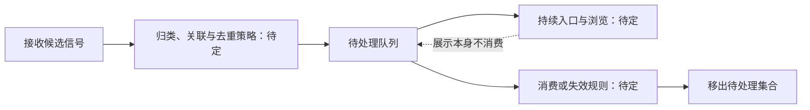

# Notification Queue Design Exploration

## Context

状态：设计探索，尚未批准实现。2026-10-15 用户明确要求先设计，暂不决定什么动作算处理完。本文的候选方案都可以修改。

已知问题是“notify 显示一下会错过”。这至少有两个不同问题：待注意的信息会消失；用户没有回到看板就看不到它。持久队列可以解决前者，未必解决后者。验收不能只检查队列文件是否存在。

现状来自 PR #10：

- Hook 覆盖每个 pane 的最新状态 spool，`stop` 可发 OSC 9；spool 不是事件日志。
- TUI 打开时从 daemon 读取快照，并在扫描之间读取最新 Hook。
- Agent 的已读完成标记与本轮完成时间关联，跳转/打开焦点已有相关行为；新队列是否沿用它尚未决定。
- 只有 daemon 打开 redb；关闭看板后 daemon 可继续存在，但当前没有持续扫描。
- `zellij pipe` 返回成功只能直接证明命令执行成功，不能未经验证就当作用户已看见目标 pane。

参考：`scripts/zellij-agent-board-hook.sh`、`src/lib.rs` 中的 `Board`（位于产品 crate）、`board_tui.rs` 中的 `persist_done_seen` / `send_jump`、`docs/design/host-state.md`。历史设计文档的个别接口字段已落后于 #10，接口细节以代码为准。

## Goals / Non-Goals

**Goals:**

- 先明确一项队列元素代表什么、何时入队、怎样离开队列。
- 设计用户错过第一次提示后的可发现入口与恢复路径。
- 为候选产品语义列出可验证的场景，再收敛存储与模块职责。

**Non-Goals:**

- 本次探索不推进 PR #11 的实现，不确定快捷键、布局或数据库结构。
- 尚未约定的通知范围、永久历史、提醒频率和容量不能作为首版承诺。

## Decisions

### D1 — 队列元素的含义：待定

| 候选 | A 连续完成两轮、用户都没看时 | 好处 | 代价 |
| --- | --- | --- | --- |
| 每个事件一项 | A 的两个完成事件分别占一项 | 保留每次发生的事情 | 容易积压；完成与授权重试可能刷屏 |
| 每个 Agent 一项 | A 占一项，更新最新状态，可另记累计次数 | 接近“下一步去看哪个 Agent” | 不能只靠队列重建每次事件；旧原因可能被合并 |
| 每个回合一项 | 两个回合各一项，回合内相关事件更新 | 可合并同轮重试，又能区分回合 | 需要各 CLI 都能提供或稳定推导回合身份 |

不能把三者混用：例如界面按 Agent 合并、确认却删除该 Agent 所有事件，会误清刚到达的消息。

需要先讨论：用户回来时主要是“去看 A”，还是要逐条确认 A 的两个结果？当前没有答案。

### D2 — 入队范围与过时规则：待定

候选范围是仅完成、完成加待授权，或另含失败/中断。不能因为几类 Hook 都能监听就全部入队。

- 授权后 Agent 继续工作：旧授权项是历史记录，还是已失效的待办？
- 失败后自动重试成功：应展示两个事件、一个最终结果，还是一个已恢复项？
- 用户就在目标 pane 且专注时完成：仍入队，还是视为已看到？需要什么可靠的焦点证据？
- 新回合开始：能否证明上轮通知被用户注意到了？自动触发的新回合可能没有这个含义。
- 睡眠、退出、pane 关闭：保留原因、显示不可跳转，还是按某种策略失效？

这些规则确定后，才能把 raw Hook、队列元素与 Agent 状态的关系写成状态机。

### D3 — 什么算处理完：用户明确暂不决定

| 候选 | 消费时机 | 优点 | 必须解决的问题 |
| --- | --- | --- | --- |
| 访问即处理 | 成功到达对应 Agent 后 | 连续处理多个 Agent 时操作少 | 实际跳转成功的证据；失败、已退出目标和预览如何处理 |
| 显式确认 | 用户对选中项执行确认 | “看过”和“处理完”可以区分 | 增加操作负担；批量确认能否避免误清新项 |
| 新交互推断 | 用户在对应 Agent 开始下一轮 | 接近自然工作流 | 自动 prompt 和人工输入能否区分；失败项如何结束 |

仅打开看板或展示提示不应被直接推断为处理完。`Enter` 跳转和 `x` 确认只是 #11 试作的交互，尚未选定。

消费动作应针对用户实际选中的版本。无论最终按事件还是 Agent 聚合，都需要避免“A 的新通知恰好到达，被旧动作一起清掉”。具体 ID 或版本方式在语义明确后设计。

### D4 — 如何持续引起注意：待定

| 候选入口 | 看板打开 | 看板关闭 | 关注点 |
| --- | --- | --- | --- |
| 看板内角标和列表 | 待处理数量持续存在 | 用户必须主动打开 | 最少干扰，但可能仍解决不了“没法注意” |
| Zellij 持续可见入口 | 可展示待处理数量 | 可在用户工作时展示 | 需调查可用插件/状态栏能力与现有布局关系 |
| 逐条浮层或重复提醒 | 当前项可持续展示 | 可以主动打断用户 | 抢焦点、提醒节流、多个看板与通知风暴 |
| 终端或系统通知加持久入口 | 可作为额外提示 | 受终端支持和系统设置影响 | 展示、送达、已读不是同一件事 |

持久入口和主动提醒可以组合，但何种组合值得首版投入仍待评审。不要在队列数量存在时就宣布“用户一定注意到了”。

### D5 — 状态模型：只列共同约束，暂不落定转换

这里的“移出待处理集合”不等于从磁盘物理删除；是否保留历史、保留多久也未决定。

### D6 — 模块职责候选：产品决策之后再选存储

将接收、关联、排序、去重和消费语义集中在通知模块；TUI 只表达用户意图并展示结果，Hook 只提交信号。这样不会把“怎样才算同一项”的规则散在脚本、渲染与按键处理中。

候选接口形状仅用于讨论：接收信号、读取待处理投影、提交针对明确版本的处理动作。字段、路由、存储格式尚未决定。测试应从这一接口验证重复信号、乱序和处理动作，而不是把文件名当成用户行为。

| 存储/投递候选 | 适合的地方 | 要付出的代价 |
| --- | --- | --- |
| 持久文件队列为权威 | Hook 无需 daemon 在线；接入直接 | 确认与去重跨文件、顺序、容量和恢复都要单独设计 |
| 持久 ingress + daemon/redb 为权威 | 保留现有单写者；可事务化关联与消费 | 需要幂等导入与 ingress 回收协议，不能漏或重复恢复 |
| Hook 直接调用 daemon | 可即时分配顺序和去重 | daemon 不在线、超时或升级时必须定义重试/落盘；不能拖慢 Agent |

PR #11 的文件方案只是第一个候选的试作。没有比较后的选择结论。

### D7 — 身份、顺序与去重的验证问题

- `(session, pane)` 定位 live Agent，但 pane/session 可重建；旧通知不能无条件指向新实例。需要调查 CLI 会话 ID、进程代际和关闭证据。
- 一秒内同 pane 可发生两次真实完成；仅靠秒级完成时间无法当事件 ID。
- Cursor 配套完成 Hook 与网络/进程重试的重复消息不是同一个问题；去重不能误吞两次真实完成。
- 文件 mtime 与随机文件名都不能天然证明业务顺序。应明确选发生顺序、接收顺序还是展示优先级；并定义并发与时钟回拨的行为。
- daemon 不在线、重启、导入成功但清理 ingress 前崩溃，应有可重复执行的恢复路径。
- 消费已完成但响应丢失时重试，不得消费下一项；多看板并发动作也应遵守这一点。

## Risks / Trade-offs

- 队列成为长期档案、积压后拖慢快照 → 先确定保留目标，再评估容量、分页和清理；不得静默丢未处理项。
- 为了可靠性让每次 Hook 同步启动 daemon 或等待慢扫描 → 验证 Hook 延迟与离线入口，保留现有快照响应性。
- 为了“提醒”不断抢焦点 → 先确定看板关闭时的使用方式，再选择提醒手段与节流。
- 合并或自动失效让用户找不到旧结果 → 在规格中逐例明确，不能用存储清理规则代替产品决策。
- 长期保存 prompt、命令或消息正文 → 先确认用户需要的信息，默认只考虑定位与原因等必要摘要；具体字段尚未决定。

## Migration Plan

本次只引入 OpenSpec，不改变运行行为或持久数据。

后续方案若需要升级 Hook、状态格式或 daemon，必须先定义安装顺序、旧 Hook/新 TUI 混用行为、幂等重放和回滚。既有 spool 只包含最新状态，不能承诺追溯完整历史。PR #11 尚未部署，默认不需要为它设计数据迁移；若发现有人试用其数据，再单独记录兼容范围。

## Open Questions

| 编号 | 待决定事项 | 依赖 |
| --- | --- | --- |
| Q1 | 用户要逐条处理事件，还是逐个访问 Agent？ | 队列粒度、界面和数据身份 |
| Q2 | 什么算处理完？ | 消费状态机；用户明确暂不决定 |
| Q3 | 看板关闭时，怎样才能注意到？ | 主动提醒、持续入口与焦点策略 |
| Q4 | 首版收哪些信号，哪些可自动失效？ | 入队范围与旧项保留 |
| Q5 | 重启、故障和容量的承诺到什么程度？ | 存储、分页、恢复与迁移 |

建议讨论顺序是 Q1 → Q3 → Q2/Q4 → Q5，避免先锁定技术方案。该顺序只是讨论建议。

## Review Scenarios

以下是评审输入，不是已批准的验收结果；每行都需要补上选定策略的期望，再生成实现任务。

| 场景 | 评审要回答的结果 |
| --- | --- |
| A 完成，用户没看到，A 又开始并完成一轮 | 回来时看到一项还是两项，怎样访问旧结果？ |
| A 待授权后已继续工作，用户才打开列表 | 旧授权项继续占位、标为失效，还是转成最新原因？ |
| 用户确认旧项的一瞬间，同一 Agent 新完成 | 新信息是否仍可发现，动作作用到哪个版本？ |
| 跳转命令返回成功，但目标 session 已消失 | 是否仍待处理，如何解释失败？ |
| 用户在看板外持续工作十分钟 | 什么入口让其知道仍有通知，能否控制打扰？ |
| daemon 未运行时产生消息，然后重启 | 是否恢复、顺序如何、怎样避免重复？ |
| 两个看板同时消费、首次响应又丢失 | 重试和另一客户端各看到什么？ |
| pane ID 被新 Agent 复用 | 如何避免把旧项跳转给新实例？ |
| 数千条通知或 ingress 文件损坏 | 用户还能打开看板吗，是否说明遗漏或降级？ |
